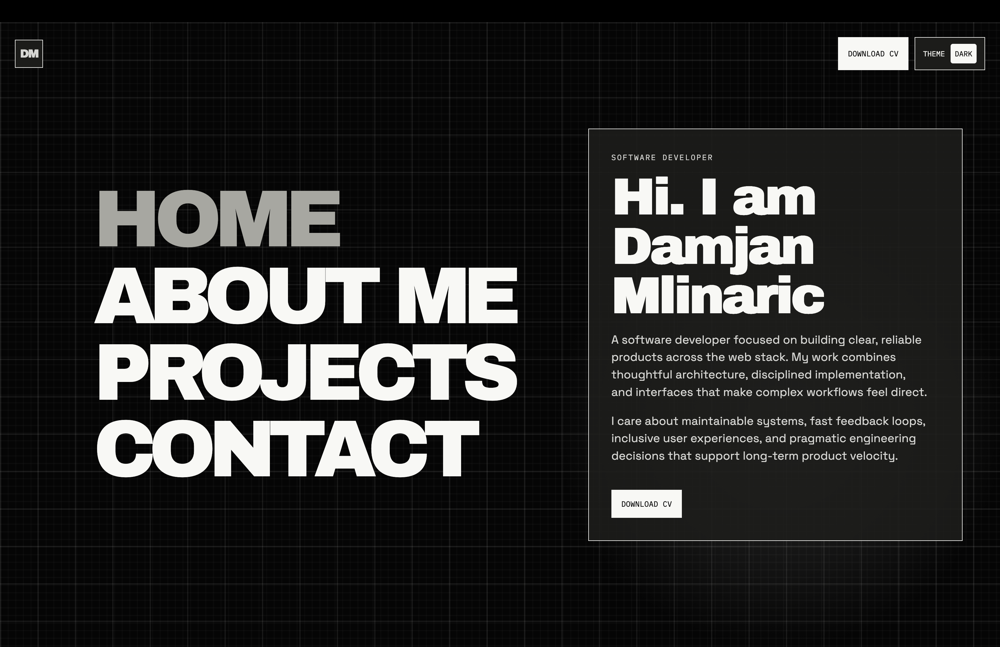
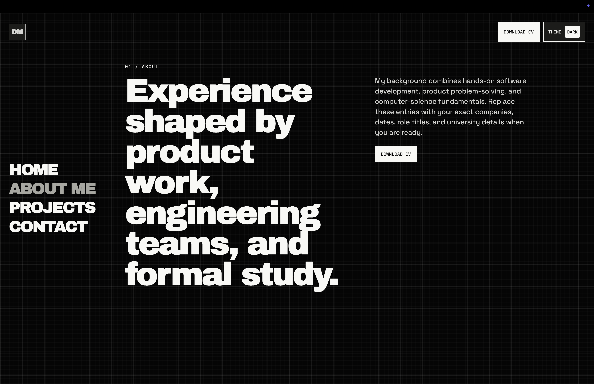
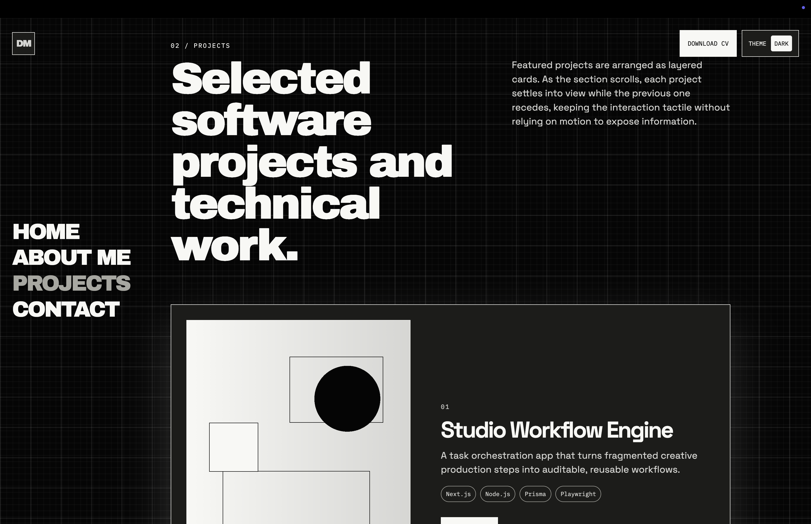
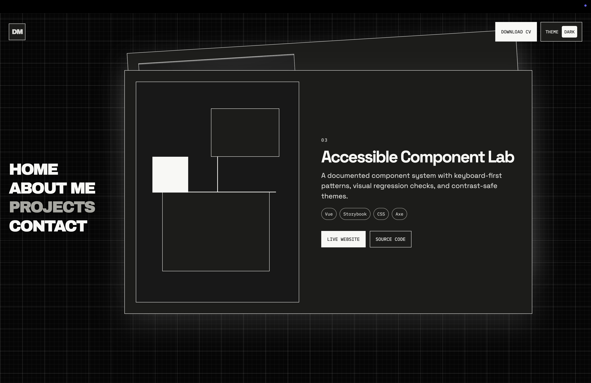
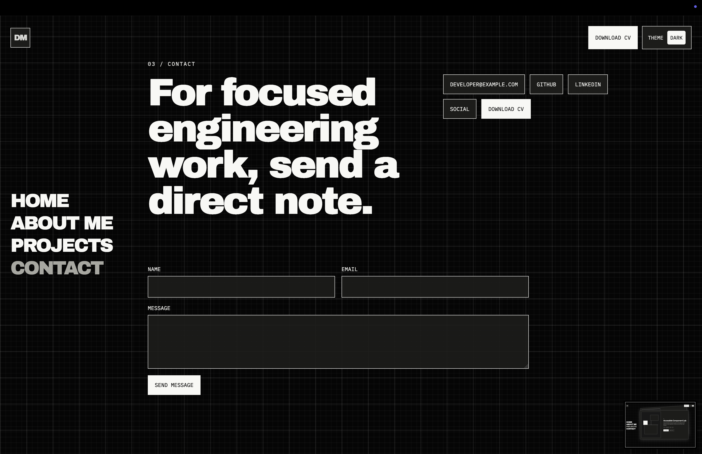
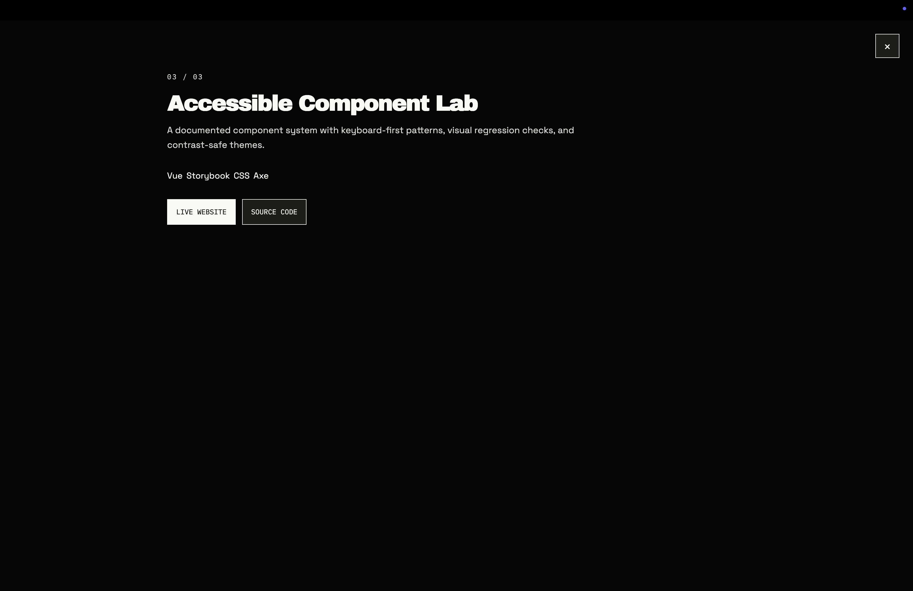

# Editable Portfolio

A bold, editable Rails portfolio with a password-protected admin panel, custom CSS animation, theme controls, PostgreSQL, and ActiveStorage project image uploads.

<p align="center">
  <picture>
    <source media="(prefers-color-scheme: light)" srcset=".images/light-home.png">
    <source media="(prefers-color-scheme: dark)" srcset=".images/dark-home.png">
    
  </picture>
</p>

## Preview

This portfolio uses a high-contrast editorial layout, oversized navigation typography, a grid-based background system, and layered project cards to keep the public site visually direct while keeping the content fully manageable from Rails admin screens.

## Screenshots

<table>
  <tr>
    <td width="50%" align="center">
      <picture>
        <source media="(prefers-color-scheme: light)" srcset=".images/light-about.png">
        <source media="(prefers-color-scheme: dark)" srcset=".images/dark-about.png">
        
      </picture>
      <br>
      <sub>About section with large editorial type and anchored navigation.</sub>
    </td>
    <td width="50%" align="center">
      <picture>
        <source media="(prefers-color-scheme: light)" srcset=".images/light-projects-overview.png">
        <source media="(prefers-color-scheme: dark)" srcset=".images/dark-projects-overview.png">
        
      </picture>
      <br>
      <sub>Projects overview with layered cards and technology tags.</sub>
    </td>
  </tr>
  <tr>
    <td width="50%" align="center">
      <picture>
        <source media="(prefers-color-scheme: light)" srcset=".images/light-project-card.png">
        <source media="(prefers-color-scheme: dark)" srcset=".images/dark-project-card.png">
        
      </picture>
      <br>
      <sub>Focused project card with live-site and source-code actions.</sub>
    </td>
    <td width="50%" align="center">
      <picture>
        <source media="(prefers-color-scheme: light)" srcset=".images/light-contact.png">
        <source media="(prefers-color-scheme: dark)" srcset=".images/dark-contact.png">
        
      </picture>
      <br>
      <sub>Contact section with social links and persisted message form.</sub>
    </td>
  </tr>
</table>

<p align="center">
  <picture>
    <source media="(prefers-color-scheme: light)" srcset=".images/light-project-detail.png">
    <source media="(prefers-color-scheme: dark)" srcset=".images/dark-project-detail.png">
    
  </picture>
  <br>
  <sub>Project detail overlay for deeper project context.</sub>
</p>

## Highlights

- Public portfolio with animated section navigation and light/dark theme support
- Password-protected admin panel for editing site copy, projects, timeline entries, info cards, and contact links
- Contact form backed by persisted messages and an admin review flow
- ActiveStorage uploads for project images, with local disk storage by default
- Docker-based local development stack with PostgreSQL

## Requirements

- Ruby `3.3.10`
- Docker for local PostgreSQL, or a local PostgreSQL install
- Rails dependencies from `bundle install`

## Setup

Run the full local stack with Docker:

```sh
ADMIN_PASSWORD="change-me" docker compose up --build
```

Open the public portfolio at `http://localhost:3000`.

Open the admin panel at `http://localhost:3000/admin` and sign in with `ADMIN_PASSWORD`.

Or run Rails on your host machine and only use Docker for PostgreSQL:

```sh
docker compose up -d postgres
bundle install
bin/rails db:prepare
bin/rails db:seed
ADMIN_PASSWORD="change-me" bin/rails server
```

The development database defaults are:

```sh
POSTGRES_HOST=localhost
POSTGRES_PORT=5432
POSTGRES_USER=portfolio
POSTGRES_PASSWORD=portfolio
POSTGRES_DB=portfolio_development
POSTGRES_TEST_DB=portfolio_test
```

## Code Formatting

Ruby is formatted with [RuboCop](https://rubocop.org) (`rubocop-rails-omakase`), enforced by a [Lefthook](https://lefthook.dev) pre-commit hook and by CI (`bin/rubocop -f github`).

On every `git commit`, `bin/pre-commit-rubocop` auto-corrects the staged `*.rb` files (`bin/rubocop -a`, safe fixes only), re-stages the corrected files, and blocks the commit with a message if any offenses remain. Partially staged files are only checked, never auto-corrected, so unrelated unstaged changes are never swept in.

Enable the hooks once per clone:

```sh
npm install
npm run hooks:install   # bin/setup does this automatically
```

Manual use: `bin/rubocop` (check), `bin/rubocop -a` (safe auto-correct). Emergency bypass: `git commit --no-verify` — CI will still fail on offenses, so use it sparingly.

## Editable Content

The admin panel manages:

- Site text, meta description, section titles, contact email, light/dark theme colors
- Work experience and education timeline entries
- Info cards, including comma-separated tag lists
- Projects, including comma-separated technologies and uploaded images
- Contact/social links

## Image Storage

Development uses local disk storage through ActiveStorage.

Production defaults to local storage unless you set:

```sh
ACTIVE_STORAGE_SERVICE=amazon
AWS_ACCESS_KEY_ID=...
AWS_SECRET_ACCESS_KEY=...
AWS_REGION=us-east-1
AWS_BUCKET=...
```

For S3-compatible providers such as Cloudflare R2, DigitalOcean Spaces, or MinIO, also set:

```sh
AWS_ENDPOINT=...
AWS_FORCE_PATH_STYLE=true
```
